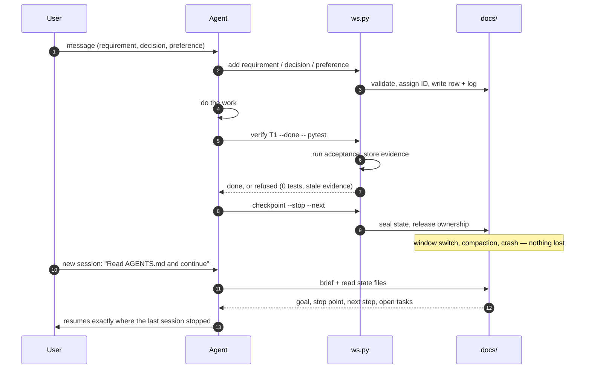

# Design

**[中文](DESIGN.zh-CN.md)** | English

Why this template exists, what problems it solves, and the reasoning behind its structure.

## The problem

AI coding agents lose track of long projects. A session that started well drifts: the agent
forgets a constraint the user stated three hours ago, re-proposes a feature the user already
rejected, claims a task is done without running the test, or asks the same question again after
a context compaction. Switching tools makes it worse — the new tool starts from zero.

The root cause is simple: the agent's memory is its context window. Everything outside the window
is gone. Context compaction makes the window smaller. Switching tools throws it away entirely.

## The approach

Move the memory out of the context window and into files. Plain Markdown, in the project folder,
readable by any tool and any human. The agent reads them at session start, writes to them during
work, and seals them at checkpoints. The next session — same tool or different — picks up from
what the last one recorded.

This is not a new idea. What makes it work here is the tooling: a CLI that validates every write,
assigns IDs, runs acceptance tests, and refuses to seal a checkpoint when the state is inconsistent.
It cannot make an agent record what the agent never writes down; "Evidence and limits" below says what
it can check.

## The flow

## Design principles

### 1. Files, not a database

Every fact lives in a Markdown file under `docs/`. No server, no daemon, no binary format. Any
editor, any `grep`, any agent tool can read the workspace. Git diffs show what changed and why.

The tradeoff is that the agent must read and write files correctly. The CLI tool handles the
mechanics: table formatting, ID assignment, log appending, conflict detection.

### 2. Record first, act second

Every user message is checked for new requirements, decisions and preferences before any work
begins. This is the first rule in AGENTS.md, and a per-turn hook repeats it on every message.

The reason: requirements that are recorded late (or never) are the ones that get lost. A user
who says "no SQLite" in passing will not repeat it. If the agent does not write it down
immediately, it is gone after compaction.

### 3. One fact, one place

Each kind of fact has exactly one owner file. Requirements go in `REQUIREMENTS.md`. Decisions go
in `DESIGN.md`. Tasks go in `TASKS.md`. The handoff card in `HANDOFF.md` points at the stop
point and next step. Nothing is duplicated.

When a fact is referenced elsewhere, it is by ID (`R1`, `T3`, `D7`), never by copying the text.
This prevents drift between copies.

### 4. Verified, not claimed

A task is done only when its acceptance command passes in the current session. The tool runs
the command, stores the output, and marks the task done. An agent saying "it works" is not
evidence.

Zero tests is not a pass. Skipped tests are shown. A run that tests less than the previous
accepted run is flagged. Test files that changed after the evidence was recorded make it stale.

### 5. Small, composable files

Seven state files, each with a single responsibility:

| File | Holds | Read when |
| --- | --- | --- |
| `HANDOFF.md` | Stop point, next step, risks, ownership | Every session start |
| `REQUIREMENTS.md` | What the user wants, with acceptance criteria | Every session start |
| `PREFERENCES.md` | Stable user preferences | Every session start |
| `FEATURES.md` | Current and retired capabilities | Before adding or removing a feature |
| `TASKS.md` | Work items, acceptance, evidence | Before starting a task |
| `ARCHITECTURE.md` | Entry points, commands, environment | Before running a command |
| `DESIGN.md` | Approach, decisions, rejected options | Before making a design choice |

The first three (plus AGENTS.md) are the "T0" files — read at every session start. The other
four are "T1" — read before the action they govern.

### 6. IDs are permanent

A requirement, task or decision gets an ID when it is created. That ID is never reused, even
after the row is retired. A retired row keeps its ID and gains a reason: `replaced by R5`,
`removed: too much scope`.

This means a new session can always tell whether something was deliberately removed or
accidentally forgotten.

### 7. The tool enforces, the agent decides

The CLI tool handles what can be checked mechanically: table structure, ID uniqueness, evidence
freshness, budget limits, conflict markers, credential patterns. It refuses to write when
something is wrong.

The agent handles what requires judgment: what the user meant, which requirement a message
maps to, whether a test is sufficient. The tool cannot judge meaning, and does not try.

### 8. Parallel work is allowed, conflicts are refused

Multiple agent windows can work on the same project. Each session claims tasks by the file
paths in their scope. Overlapping claims are refused. The user can force a claim with a reason,
which is logged.

The workspace lock is a system file lock on `.agents/cache/ws.flock`. It ends with the process that
holds it, so a crashed or killed window never leaves a lock behind. A window that was taken over can
still run commands, but its writes are refused because another session owns the workspace.

### 9. Credentials follow the user's decision

The tool asks once how the project handles credentials: keep them as written, redact them,
or ask each time. The answer is recorded as a preference and a WORKSPACE setting, and every
write path follows it.

Invisible characters (zero-width space, soft hyphen, BOM) that would split a key and hide it
from pattern matching are detected and handled. Host data that is neither user text nor a
credential (Codex's encrypted compaction blobs) is never stored.

### 10. Host adapters are thin

AGENTS.md is the single contract. Each host tool loads it through a thin adapter: a `CLAUDE.md`
that imports it, a `.gemini/settings.json` that names it, a `.kiro/steering/workspace.md` that
points at it. The adapter does nothing else.

This means the workspace works the same way on every host, and switching hosts does not change
the rules.

## What this is not

- **Not a project management tool.** It does not track deadlines, assign people, or draw Gantt
  charts. It tracks what the user asked for and whether it was delivered.
- **Not a replacement for version control.** It works alongside git (or without it). It records
  requirements and evidence; git records code changes.
- **Not a guarantee of quality.** It guarantees that facts are recorded and tests are run.
  Whether the facts are right and the tests are sufficient is the agent's job.
- **Not a lock-in.** Everything is plain text. Delete `.agents/` and the project is a normal
  folder with some Markdown files.

## Evidence and limits

The design is informed by:

- **Real use**: 162 sessions across Claude Code, Codex, Kiro and Gemini in one project, with
  every failure traced back to a missing record or a missing check.
- **Research**: Compact-Bench (compression destroys 5–64% of task completion), CONPACT
  (constraints survive only 17% after compaction without separate tracking), ImpossibleBench
  (models cheat on 22–54% of conflicting tests), ETH Zurich's AGENTS.md evaluation (context
  files alone do not improve success rates).
- **Host documentation**: each tool's instruction file limits, hook capabilities, transcript
  formats and trust models, checked against official docs and source code.

Known limits:

- No file can force a model to record. The per-turn hook repeats the rule, and a goal with no
  requirement rows blocks READY, but the agent must still follow it.
- The tool cannot tell which sentence was a requirement. Reconciliation turns saved messages
  into a checklist; the agent must answer it truthfully.
- Pattern-based redaction misses a secret with no label and no login context. The prompt hook
  tells the agent to ask before writing a credential anywhere.

## Rejected alternatives

Several approaches were tried and rejected:

| Alternative | Why rejected |
| --- | --- |
| A database or a server | Adds a dependency, a point of failure and a barrier to reading the workspace |
| Facts extracted by a model | Needs model calls the tool cannot make; the failures seen were facts overwritten or duplicated |
| One large AGENTS.md | Hosts cut it at 24 to 32 KB; the contract must live beside the project's own rules |
| Deleting finished rows automatically | The user may need to see why something was done or removed |
| Hash-based IDs (beads, git-bug) | They do not prevent Markdown table conflicts and make the files harder to read |
| A merge driver for parallel copies | No project of the owner is under git; parallel copies are folders never merged back |
| Blocking a prompt that contains a credential | Hosts handle blocks inconsistently; the hook warns instead |
