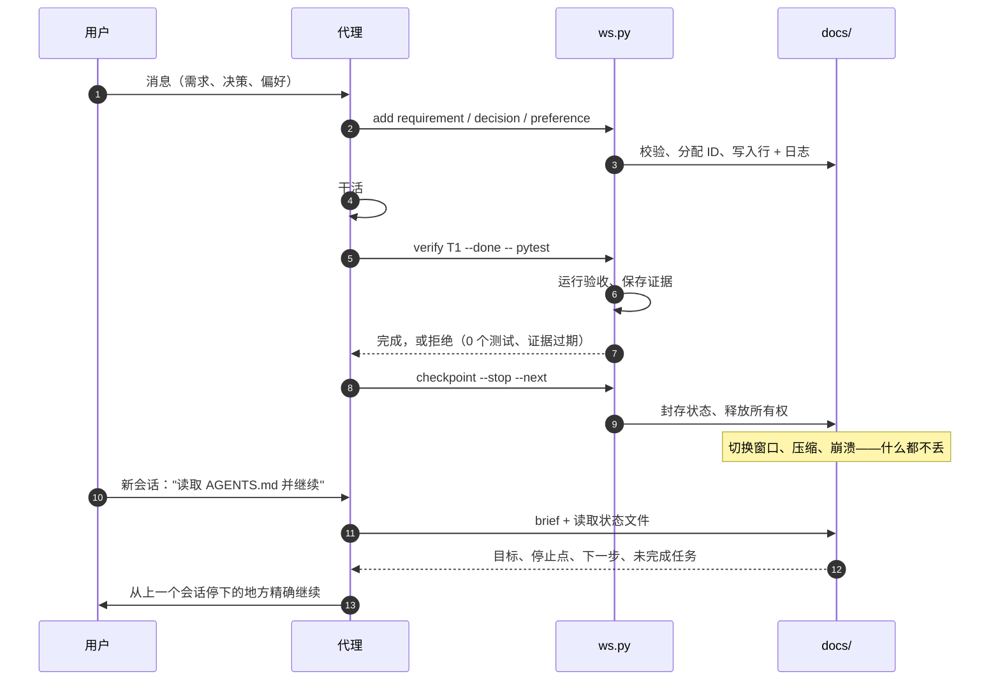

# 设计

中文 | **[English](DESIGN.md)**

为什么这个模板存在，它解决什么问题，以及结构背后的推理。

## 问题

AI 编程代理在长项目中会丢失进度。一个开始良好的会话会逐渐偏离：代理忘记用户三小时前说过的
约束、重新提议用户已经否决的功能、没有运行测试就声称任务完成、或者在上下文压缩后再次问同一个
问题。切换工具让情况更糟——新工具从零开始。

根本原因简单：代理的记忆就是它的上下文窗口。窗口之外的一切都丢失了。上下文压缩让窗口更小。
切换工具则把窗口完全丢弃。

## 方法

把记忆从上下文窗口搬到文件里。纯 Markdown，放在项目文件夹中，任何工具和任何人都能读。代理在
会话开始时读取它们，在工作过程中写入，在检查点封存。下一个会话——同一个工具或不同的——从
上一个停下的地方继续。

这不是一个新想法。让它真正起作用的是工具链：一个 CLI，验证每次写入、分配 ID、运行验收测试、
在状态不一致时拒绝封存检查点。代理不能跳过记录，因为工具强制执行。

## 流程

## 设计原则

### 1. 文件，不是数据库

每个事实存放在 `docs/` 下的 Markdown 文件中。没有服务器、没有守护进程、没有二进制格式。
任何编辑器、任何 `grep`、任何代理工具都能读取工作区。Git diff 显示什么变了、为什么。

代价是代理必须正确地读写文件。CLI 工具处理机械部分：表格格式化、ID 分配、日志追加、冲突
检测。

### 2. 先记录，再行动

每条用户消息在任何工作开始之前都会检查是否包含新的需求、决策和偏好。这是 AGENTS.md 的
第一条规则，每轮钩子也会在每条消息上重复提醒。

原因：记录晚了（或从未记录）的需求是最容易丢失的。用户随口说的"不要用 SQLite"不会重复
第二遍。如果代理不立即写下来，压缩之后它就消失了。

### 3. 一个事实，一处存放

每种事实有且只有一个归属文件。需求放在 `REQUIREMENTS.md`。决策放在 `DESIGN.md`。任务放在
`TASKS.md`。`HANDOFF.md` 中的交接卡指向停止点和下一步。没有重复。

当事实在别处被引用时，用 ID（`R1`、`T3`、`D7`），永远不复制文本。这防止了副本之间的漂移。

### 4. 验证，不是声称

任务只有在验收命令通过之后才标记为完成。工具运行命令、保存输出、标记完成。代理说"能用了"
不是证据。

零个测试不算通过。跳过的测试会显示。比上次验收运行测试数量更少的运行会被标记。在证据记录
之后修改过的测试文件使证据过期。

### 5. 小文件，各司其职

七个状态文件，每个有单一职责：

| 文件 | 存放 | 何时读取 |
| --- | --- | --- |
| `HANDOFF.md` | 停止点、下一步、风险、所有权 | 每次会话开始 |
| `REQUIREMENTS.md` | 用户想要什么，附验收标准 | 每次会话开始 |
| `PREFERENCES.md` | 稳定的用户偏好 | 每次会话开始 |
| `FEATURES.md` | 当前和已退役的功能 | 添加或删除功能之前 |
| `TASKS.md` | 工作项、验收、证据 | 开始任务之前 |
| `ARCHITECTURE.md` | 入口点、命令、环境 | 运行命令之前 |
| `DESIGN.md` | 方案、决策、被否决的选项 | 做设计选择之前 |

前三个（加上 AGENTS.md）是"T0"文件——每次会话开始必读。其余四个是"T1"——在它们管辖的
操作之前阅读。

### 6. ID 永久

需求、任务或决策在创建时获得 ID。该 ID 永不复用，即使行被退役。退役的行保留 ID 并获得
原因：`被 R5 替代`、`已删除：超出范围`。

这意味着新会话总能区分某样东西是被有意删除的还是被意外遗忘的。

### 7. 工具执行，代理判断

CLI 工具处理可以机械检查的部分：表格结构、ID 唯一性、证据新鲜度、预算限制、冲突标记、
凭据模式。有问题时拒绝写入。

代理处理需要判断的部分：用户的意思、消息映射到哪条需求、测试是否充分。工具不能判断语义，
也不尝试。

### 8. 并行允许，冲突拒绝

多个代理窗口可以在同一项目上工作。每个会话按任务范围中的文件路径声明任务。重叠的声明被
拒绝。用户可以用理由强制声明，理由会被记录。

锁文件携带代际号（工作区的 revision）。被接管的窗口持有更旧的代际号，所以它的锁是过期的，
即使它的进程还活着。

### 9. 凭据跟随用户的决定

工具询问一次项目如何处理凭据：保留原样、脱敏、或每次询问。答案记录为偏好和 WORKSPACE 设置，
每次写入都遵循它。

会把密钥拆开、让模式匹配找不到的不可见字符（零宽空格、软连字符、BOM）会被检测和处理。
既不是用户文本也不是凭据的宿主数据（Codex 的加密压缩块）永远不会被存储。

### 10. 宿主适配器保持薄

AGENTS.md 是唯一契约。每个宿主工具通过一个薄适配器加载它：一个导入它的 `CLAUDE.md`、
一个命名它的 `.gemini/settings.json`、一个指向它的 `.kiro/steering/workspace.md`。
适配器不做其他任何事。

这意味着工作区在每个宿主上以相同方式工作，切换宿主不改变规则。

## 这不是什么

- **不是项目管理工具。** 不跟踪截止日期、分配人员或画甘特图。它跟踪用户要求了什么、是否
  交付了。
- **不是版本控制的替代品。** 与 git 一起工作（也可以没有 git）。它记录需求和证据；git 记录
  代码变更。
- **不是质量保证。** 它保证事实被记录、测试被运行。事实是否正确、测试是否充分是代理的工作。
- **不是锁定。** 一切都是纯文本。删掉 `.agents/`，项目就是一个带有一些 Markdown 文件的普通
  文件夹。

## 证据与限制

设计依据：

- **真实使用**：一个项目中 Claude Code、Codex、Kiro 和 Gemini 的 162 个会话，每次失败都
  追溯到缺失的记录或缺失的检查。
- **研究**：Compact-Bench（压缩破坏 5–64% 的任务完成）、CONPACT（没有单独跟踪时约束在压缩
  后只保留 17%）、ImpossibleBench（模型在 22–54% 的矛盾测试上作弊）、ETH Zurich 的 AGENTS.md
  评估（上下文文件本身不提高成功率）。
- **宿主文档**：每个工具的指令文件限制、钩子能力、聊天格式和信任模型，对照官方文档和源码
  核实。

已知限制：

- 没有文件能强制模型记录。每轮钩子重复规则，没有需求行的目标会阻止 READY，但代理仍须遵循。
- 工具不能判断哪句话是需求。对账把保存的消息变成检查清单；代理必须诚实回答。
- 基于模式的脱敏会漏掉没有标签和登录上下文的密钥。提示钩子告诉代理在写入凭据之前先询问。

## 被否决的替代方案

尝试过并否决的方案：

| 替代方案 | 否决原因 |
| --- | --- |
| 数据库或服务器 | 增加依赖、故障点和读取工作区的门槛 |
| 用模型自动提取事实 | 需要工具无法发起的模型调用；实测的失败是事实被覆盖或重复 |
| 单一大 AGENTS.md | 宿主在 24–32 KB 处截断；契约必须与项目规则共存 |
| 自动删除完成的行 | 用户可能需要查看某事为什么被完成或删除 |
| 基于哈希的 ID（beads、git-bug） | 它们不能防止 Markdown 表格冲突，还让文件更难读 |
| 并行副本的合并驱动 | 所有者的项目不在 git 下；并行副本是文件夹，从不合并回来 |
| 阻止包含凭据的提示 | 各宿主对阻止的处理不一致；钩子改为警告 |
