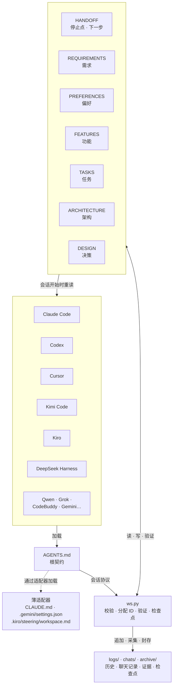

# Agent workspace template

中文 | **[English](README.md)**

一个为 AI 编程代理设计的、基于文件的记忆系统。它让任何代理工具——Claude Code、Codex、
Cursor、Kimi Code、Kiro、DeepSeek Harness 等——拥有一份共享的持久记忆，在切换窗口、
上下文压缩和更换工具之后仍然保留。

项目的每一个事实都以纯 Markdown 文件的形式存放在 `docs/` 下。新会话读取这些文件，
从上一个会话停下的地方继续。不需要数据库，不需要服务器，没有锁定：只用 Python 标准库、
纯文本和一个命令行工具。

## 为什么需要它

AI 代理在长项目中会丢失进度。它们忘记需求、重复已完成的工作、提议用户已经否决的功能、
没有运行测试就声称任务完成。这个模板通过让代理把每一条需求、决策、任务和证据记录在文件中，
使下一个会话在动手之前就能读到它们，从而防止这些问题。

### 它解决哪些需求

- **跨越多个会话的长项目。** 代理在碰任何代码之前，重新读取目标、当前任务、精确的停止点
  和下一步——而不是依赖它自己写的摘要。
- **上下文压缩。** 宿主压缩对话时，代理没写下来的东西就丢了。在这里，需求、禁令和决策都
  在磁盘上，压缩不损失任何东西。聊天记录被复制到项目里，`ws reconcile` 把每条保存的用户
  消息变成检查清单，直到每一条都有了着落。
- **切换窗口或工具。** 在 Claude Code 里开始的会话可以在 Codex 或 Kimi Code 里继续：它们
  读的是同一份 `AGENTS.md` 和同一套状态文件。交接卡说明工作停在哪里，证据文件说明什么
  真正验证过。
- **需求变更。** 每条需求有永久 ID。替代一条需求时，工具列出引用它的未完成任务和功能，
  后续工作随之更新，而不是悄悄继续实现旧行为。已删除的功能连同原因保留可见，不会被重新
  提议。
- **完成的证据。** 每个任务自带验收命令。`ws verify` 运行它、保存输出，只在通过时标记
  完成——零个测试、跳过的测试、过期的证据都会被报告，不会被悄悄接受。
- **并行代理窗口。** 会话按文件路径和资源名声明任务，重叠的声明被拒绝。代际号落后于工作区
  当前 revision 的锁会被回收，被接管的窗口无法继续写入。
- **凭据。** 你决定一次项目如何处理凭据：保留原样、脱敏、或每次询问。每条写入路径都遵循
  这个决定，包括聊天记录。

## 架构

每个代理工具通过一个薄适配器加载同一个根契约 `AGENTS.md`。代理运行 `ws.py` 来记录和验证；
工具读写 `docs/` 下的 Markdown 文件。下一个会话开始时，代理重新读取这些文件，因此记忆在
切换窗口、压缩和更换工具之后仍然保留。



从上到下：**代理工具**、共享的 **`AGENTS.md` 契约**及其薄适配器、**`ws.py` 工具**，以及
**`docs/` 记忆**——`state/` 里的当前事实，加上 `logs/`、`chats/`、`archive/` 的历史。
状态文件在下一次会话开始时被重新读取，闭环就此完成。

## 仓库结构

```text
agent-workspace-template/
├── AGENTS.md                     每个代理首先读取的根契约
├── CLAUDE.md                     Claude Code 适配器：一行 "@AGENTS.md"
├── CODEBUDDY.md                  CodeBuddy / WorkBuddy 适配器
├── DESIGN.md                     结构为什么这样设计
├── README.md · README.zh-CN.md   本文件（英文与中文）
├── LICENSE                       MIT
├── .gemini/settings.json         Gemini CLI / Antigravity 适配器
├── .kiro/steering/workspace.md   Kiro 适配器
├── .trae/rules/workspace.md      Trae 适配器
├── .agents/                      系统文件，每个项目里完全相同
│   ├── guides/                   QUICKSTART · PROTOCOL · STRUCTURE · HOSTS
│   ├── skills/                   按需加载的工作流
│   ├── template/                 规格与试验模板、测试结果解析器
│   │   ├── spec/                 requirements.md · design.md · tasks.md
│   │   └── examples/             unittest_json · pytest_junit · go_json
│   └── tools/                    命令行工具
│       ├── ws.py                 每个代理运行的工具
│       ├── wslib/                它的模块（core、validate、evidence 等）
│       └── tests/                模板自测（不会安装进项目）
├── docs/                         项目的记忆——在每个项目里生成
│   ├── state/                    当前事实，每次会话开始必读
│   │   ├── HANDOFF.md            停止点 · 下一步 · 所有权
│   │   ├── REQUIREMENTS.md       用户想要什么，附验收标准
│   │   ├── PREFERENCES.md        稳定的用户偏好
│   │   ├── FEATURES.md           当前与已退役的功能
│   │   ├── TASKS.md              工作项 · 验收 · 证据
│   │   ├── ARCHITECTURE.md       入口点 · 命令 · 环境
│   │   └── DESIGN.md             决策 · 被否决的选项
│   ├── logs/                     工具写入的历史表
│   ├── chats/                    钩子复制的聊天记录
│   ├── archive/                  checks/ · checkpoints/ · closed/ · snapshots/
│   └── specs/<slug>/             单个大需求的详细内容
└── dist/                         发布包（附在 GitHub Releases）
```

把模板安装到项目时只写入运行文件：各适配器、guides、skills、templates、`ws.py` 及其模块，
以及生成的 `docs/` 骨架。维护者文件——`MAINTAINING.md`、`DESIGN_REQUIREMENTS.md`、自测、
文件夹预览——留在本仓库，永远不会复制进项目，所以业务代理的搜索不会找到模板自己的历史。

## 快速上手

1. **下载**最新发布包：
   [Releases](https://github.com/yourhoneypomelo-cell/agent-workspace-template/releases)，
   解压到一个空的项目文件夹里。

2. **在代理工具中打开项目**，然后说：

   > 读取 AGENTS.md 并开始。

3. **用一句话说明目标**。代理会创建状态文件，把目标记录为需求，然后开始工作。

4. **可选：启用钩子**，让工具自动保存聊天记录并在会话开始时注入工作区摘要：

   ```bash
   python .agents/tools/ws.py hooks enable claude
   ```

   把 `claude` 换成 `codex`、`cursor`、`gemini`、`copilot`、`kiro`、`grok`、`qwen` 或
   `codebuddy`，对应你使用的工具。

## 工作方式

```text
会话开始：  brief → 读取状态 → start → 工作并记录 → verify → checkpoint
下一次会话：  ↑                                                            |
              └────────────────────────────────────────────────────────────┘
```

- **AGENTS.md** 是每个代理都要读的根契约。它定义了会话协议、状态文件格式和保持工作区
  一致的规则。
- **`docs/state/`** 存放七个 Markdown 文件：交接卡、需求、偏好、功能、任务、架构和设计
  决策。它们是事实的唯一来源。
- **`docs/logs/`** 记录了发生了什么：会话历史、需求变更、功能变更。
- **`docs/chats/`** 保存聊天记录，不丢失任何用户消息。
- **`ws.py`** 是命令行工具，负责验证写入、分配 ID、运行验收测试、封存检查点。代理只需要
  运行它。

## 核心特性

- **先记录，再行动。** 每条用户消息在处理之前都会检查是否包含新的需求、决策和偏好。
- **验证过的完成。** 任务只有在验收命令通过之后才标记为完成。工具运行测试、保存证据、
  更新状态。
- **并行会话。** 多个代理窗口可以同时工作。任务声明通过文件路径和资源名防止冲突。过期锁
  按代际号回收，不靠猜测进程是否存活。
- **凭据安全。** 工具会询问项目如何处理凭据（保留、脱敏或每次询问），并在每次写入时遵循
  该规则。
- **宿主适配器。** AGENTS.md 是唯一契约。Claude Code、Codex、Cursor、Gemini、Kiro、
  Kimi Code、Grok、DeepSeek Harness、CodeBuddy 和 Qwen Code 的适配器原生加载它。
- **压缩存活。** 状态文件在磁盘上，不在代理的上下文窗口里。压缩之后代理重新读取它们，
  继续工作。

## 安装到已有项目

```bash
# 从模板目录运行：
python .agents/tools/ws.py install --target /path/to/your/project --merge

# 或者把发布包解压到项目根目录。
```

`--merge` 会保留你已有的 AGENTS.md，追加到"项目规则"一节。

## 设计思路

[DESIGN.zh-CN.md](DESIGN.zh-CN.md) 解释了结构背后的推理：为什么用文件而不是数据库、
为什么先记录再行动、证据如何工作、以及哪些替代方案被否决了。

## 指南

| 指南 | 用途 |
| --- | --- |
| [快速上手](.agents/guides/QUICKSTART.md) | 安装、第一个会话、日常使用 |
| [协议](.agents/guides/PROTOCOL.md) | 格式、所有权、证据和恢复 |
| [结构](.agents/guides/STRUCTURE.md) | 文件夹、命名、文档大小和写作风格 |
| [宿主](.agents/guides/HOSTS.md) | 各工具的入口文件和钩子 |

## 环境要求

**运行环境**

- Python **3.10 或更新版本**，在 PATH 中以 `python` 可用。不需要安装任何包——工具只用
  标准库。
- Windows、macOS 或 Linux。Windows 的注意事项（Git Bash 与 PowerShell、UTF-8、钩子命令）
  见 [HOSTS.md](.agents/guides/HOSTS.md)。
- 一个能读文件、能运行 shell 命令的代理工具。任何工具都可以：契约从 `AGENTS.md` 读取，
  CLI 就是纯 Python。
- 建议项目使用 git，但不是必须。工作区本身从不运行 git。

**宿主集成（可选）**

- 没有钩子工作区也能用，只是代理由自己运行 `ws brief`。钩子自动完成聊天记录采集和会话开始
  时的摘要注入。每个工具一条命令即可配置：
  `python .agents/tools/ws.py hooks enable <宿主>`，支持 `claude`、`codex`、`cursor`、
  `gemini`、`copilot`、`antigravity`、`kiro`、`codebuddy`、`qoder`、`qwen`、`grok`。
- 有些宿主会要求先信任项目或其钩子（Codex 的 `/hooks`、Qwen Code、Kiro、Qoder、WorkBuddy）。
  [HOSTS.md](.agents/guides/HOSTS.md) 列出了每个宿主的入口文件和信任步骤。
- 导入 DeepSeek Harness 的历史会话需要 Python **3.14+** 或 `backports.zstd` 包，因为它的
  存储是 zstd 压缩的。其余功能在 3.10 上都能用。

**磁盘**

模板不到 1 MB。项目的 `docs/` 随历史和聊天记录增长；`ws compact` 归档已关闭的行，
`ws check` 在文件大到宿主读不下之前发出警告。

## 许可证

[MIT](LICENSE)
